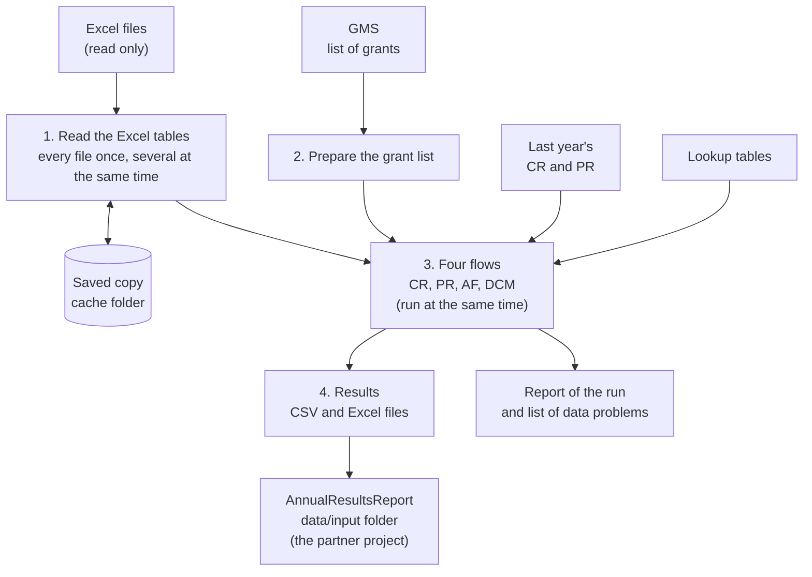

# How it works

This page explains what Combiner does, step by step. You do not need to read it to use Combiner. It helps you understand the results and find problems.

## The big picture

In words:

1.  Combiner reads the Excel tables from all your Excel files.
2.  It downloads the list of grants from the GMS and prepares it.
3.  It runs four flows. Each flow makes one combiner.
4.  It writes the results, a report, and a list of problems in the Excel files.
5.  It copies `cr_clean.xlsx`, `pr_clean.xlsx` and `grants_db.csv` to the `data/input` folder of the partner project **AnnualResultsReport**, if it is downloaded next to Combiner. ARR reads these three files.

## Step 1. Read the Excel tables

-   Combiner looks in your folder for Excel files whose names match the patterns in your settings.
-   Files whose name starts with `ARCHIVED` are skipped.
-   It opens each file **once**. It reads all the tables it needs in one go.
-   Several files are read at the same time. Each one is handled by a separate copy of R (a "worker").
-   Combiner saves what it read in the `cache` folder, together with the size and date of the file.
-   The next time, a file is read again **only** if its size or date changed.

While reading, Combiner also checks for **rows typed below a table**. Such rows are not part of the table, so they are not read. They are written to the list of data problems.

## Step 2. Prepare the grant list (GMS)

Combiner downloads the list of grants and prepares it:

-   It adds a Yes/No column for each year, for example `Activein2025`. "Yes" means the grant was running in that year.
-   It adds `ActiveStrategicPlan`.
-   For a programme, all grantees take the value of the **lead grantee**. (CR and PR only.)
-   It adds Yes/No columns about the crisis and the type of emergency.
-   For CR and PR, it removes grants of the type AF. The AF and DCM flows keep all grants.

The rules for these columns can be changed in the [settings](configuration.md).

Combiner also builds the list of **reporting windows**. For each programme it finds the latest window that ended before your cut-off date.

## Step 3. The four flows

The four flows are independent. They run at the same time. Each flow does these things:

| Flow | Main steps |
|----|----|
| **CR** | Clean the table of children. Add grant data and the reporting window. Turn the wide table into a long one (one row for each level, gender and status). Add the **Annual** and **Cumulative** rows. Add last year's rows. |
| **PR** | Clean the three kinds of result templates. Match their column names with the lookup tables and put them together. Add grant data and the reporting window. Turn baseline, target and window columns into rows. Add the **Annual** and **Cumulative** rows. Add last year's rows. Tidy dates, codes and units. |
| **AF** | Clean the funding table. Add grant data. Work out the alignment score and the total funding. |
| **DCM** | Clean the tables of money passed to partners. Add grant data. Clean the amounts. |

### Annual and Cumulative

For the current year, every row is added twice: once with the label `ARR25 Annual` and once with `ARR25 Cumulative`. Rows of earlier years come from last year's combiner.

Grants that are no longer active keep their last cumulative rows. These rows are copied into this year's cumulative report.

You can change these rules. See [Settings](configuration.md).

## Step 4. Write the results

For each flow, Combiner writes a CSV file and an Excel file. It also writes:

-   `output/run_log.csv`: how long each step took.
-   `output/checks/data_collection_issues.csv`: problems to fix in the Excel files.
-   `output/diagnostics/<date and time>/report.md`: the report of the run. A copy of the newest one is in `output/diagnostics/latest/`.

## What happens when something goes wrong

-   If **one flow fails**, the other three still finish and their results are written. Combiner then stops with an error. The report says which flow failed, where, and how far it got.
-   If something goes wrong **before the flows** (for example, the login is wrong), Combiner stops. It still writes a report with the step where it stopped and the error.

See [The run report](diagnostics.md).

## How your Excel files stay safe

-   Combiner only **reads** Excel files.
-   Before it writes any file, it checks that the place is **not inside** your Excel folder. If it is, Combiner stops.
-   Before and after each run, Combiner notes the size and date of every file in your Excel folder. If something changed during the run, it warns you. This is usually a sync program or another person.

## Where things are in the code

| Folder | What is inside |
|----|----|
| `R/extract` | Reading the Excel tables and the cache |
| `R/io` | Finding files, safety checks, writing results |
| `R/transform` | The grant list, the reporting windows and the four flows |
| `R/pipeline` | The main program, the checks and the report |
| `R/utils` | Settings, year rules, small helpers |
| `scripts` | The commands you run |
